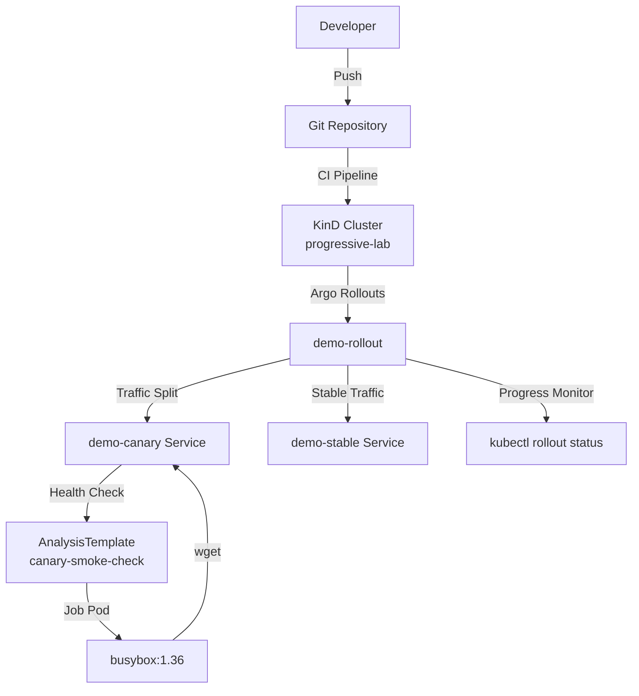

# Progressive Delivery Home Lab

## Goal & Platform Problem

This project demonstrates Progressive Delivery patterns using Argo Rollouts on a local KinD Kubernetes cluster. The goal is to provide SREs and developers with a hands-on environment to experiment with canary releases, automated analysis, and rollback strategies without requiring cloud infrastructure.

**Platform Problem:** Traditional deployments with `kubectl apply` offer no visibility into release health or automated rollback. Progressive Delivery addresses this by:
- Gradually shifting traffic to new versions (canary)
- Validating health with external metrics (analysis templates)
- Automatic rollback on failure (progressDeadlineSeconds)

## Architecture



## Stack & Design Decisions

| Component | Choice | Rationale |
|-----------|--------|-----------|
| Cluster | KinD | Lightweight, local, reproducible |
| Controller | Argo Rollouts | Native Kubernetes CRDs, mature |
| Image | argoproj/rollouts-demo | Official demo with / health endpoint |
| Service Type | ClusterIP | Internal testing, no external exposure |
| Probe | HTTP GET /:8080 | Demo app serves HTML with health state |
| Analysis Provider | Job (Pod) | Simple, deterministic, no external deps |
| Progress Deadline | 30s | Fast failure detection for CI testing |

## Quickstart & Local Validation

```bash
# Validate configuration
make validate

# Bootstrap cluster and apply manifests
make up

# Observe rollout progression
kubectl rollout status rollout/demo-rollout -n progressive-delivery --timeout=60s

# View canary steps
kubectl get rollout demo-rollout -n progressive-delivery -o yaml
```

### Manual Canary Promotion Test

```bash
# Promote canary to 100%
make promote-test

# Trigger rollback test (simulate bad release)
make rollback-test
```

### Validation Output

Run `make validate` to verify all manifests are syntactically correct and ready for deployment.

## Evidence

The `evidence/` directory contains captures from validation runs:

| File | Description |
|------|-------------|
| `01-validation.txt` | Validation script output (files, YAML syntax, shell scripts) |
| `02-cluster-and-argorollouts.txt` | KinD cluster, Argo Rollouts controller, and applied resources |
| `03-canary-promote.txt` | Canary promote (blue -> green) rollout progression + AnalysisRun |
| `04-canary-auto-rollback.txt` | Bad-canary auto-rollback (ImagePull + ProgressDeadlineExceeded) |
| `05-cleanup.txt` | Cluster teardown output |
| `06-ci-run.txt` | GitHub Actions CI run for the latest commit |

## Failure Modes & Troubleshooting

| Symptom | Cause | Resolution |
|---------|-------|------------|
| `kubectl apply -f install.yaml` fails: `metadata.annotations: Too long: may not be more than 262144 bytes` on `rollouts.argoproj.io` / `analysisruns.argoproj.io` CRDs | Client-side apply embeds the full last-applied-configuration annotation, which exceeds the 256KiB annotation limit for the large Argo Rollouts CRDs | Install with server-side apply: `kubectl apply --server-side --force-conflicts -f .../install.yaml` (already wired into `scripts/bootstrap.sh`) |
| `AnalysisTemplate` rejected / analysis never runs: `error validating data` with unknown field under `provider.job`, or `no matches for kind "AnalysisTemplate" in version "analysis.argoproj.io/v1alpha1"` | Wrong group/version and schema — `provider.job` expects a Kubernetes `JobSpec`, not a `Pod` spec | Use `apiVersion: argoproj.io/v1alpha1` and put `spec.backoffLimit: 0` + `spec.template.spec` (a `JobSpec`) under `provider.job` |
| `progressDeadlineExceeded` | New version not healthy within 30s | Check `kubectl describe rollout` for failure reason |
| Analysis job fails | Service unreachable or timeout | Verify `demo-canary` service exists, check pod logs |
| Rollout stuck at setWeight | Network policy or DNS issue | `kubectl get pods -n progressive-delivery` |
| Cluster creation fails | Port conflicts | `kind delete cluster`, check Docker status |
| `connection refused` to demo app | Pod not ready | Increase `initialDelaySeconds` in probe |

## Cost & Cleanup

**Cost:** $0 - This is a local development lab using KinD. No cloud resources are provisioned.

**Cleanup:**
```bash
# Remove cluster
make down

# Or manually
kind delete cluster --name progressive-lab
```

**Disk space:** ~2GB for KinD image and container runtime data.
